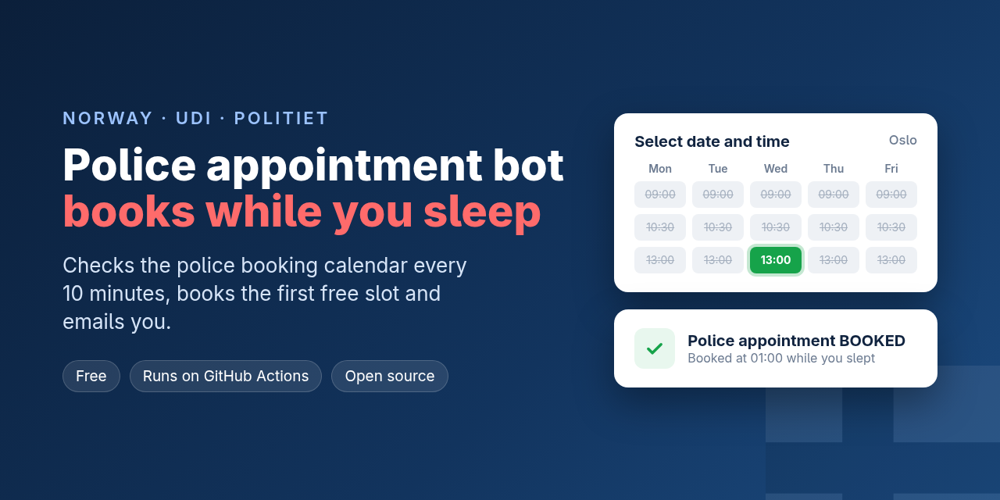
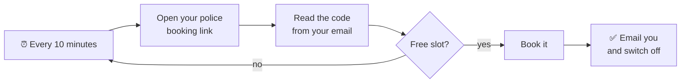

  

<h1 align="center">UDI police appointment bot (Norway)</h1>

  
  
  
  

  

**Can't get an appointment with the police (Politiet) for your UDI application?** This script checks the police
booking calendar (`politietbooking.nemo-q.se`) every 10 minutes for you. When a slot opens it books it, and it
emails you either way.

> For **5 months** I checked by hand every few days and never saw a single free slot, so I decided to stop
> wasting time and automate it. A few hours after the script started running, **around 1 a.m. on a Sunday
> night, it booked me an appointment for the following week.** Slots do open, but they're taken within minutes,
> usually when nobody is looking. I hope sharing this saves someone else the time.

It works for any UDI application where you book the police appointment through **My Applications (Mine søknader) →
Book appointment**: EU/EEA registration, residence permits, family immigration, permanent residence, citizenship,
etc. It was tested with an EU/EEA registration in Oslo.

*Unofficial. Not affiliated with UDI or the Norwegian Police. Use at your own risk.*

## What it does

Every 10 minutes it opens your booking link, reads the police's verification code from your email, and looks
for a free slot. If there is one at least 12 hours away, it books it, emails you, and switches itself off.
If something goes wrong while a slot is free, it emails you right away with screenshots, so you can still book
it yourself.

## What you need

1. **Your booking number.** You'll find it on your application's receipt page on udi.no, or in the email
   *"Book an appointment with the Police - Immigration Authorities"*.
2. **The email account where the police's emails arrive** (the one you registered with UDI), and an
   **app password** for it. Gmail is tested: see [how to get a Gmail app password](docs/email.md).
   Other providers may work too.
3. **Somewhere to run it every 10 minutes.** Pick one:

| Option | Cost | Works while your computer is off? |
|---|---|---|
| **[GitHub Actions](docs/github-actions.md)**, the easiest choice | free | ✅ yes, it runs on GitHub's servers |
| [An always-on Linux machine](docs/always-on-linux.md) (home server, Raspberry Pi, VPS) | free to €4/month | ✅ yes |
| [Your own Mac or Linux computer](docs/mac-linux.md) | free | ❌ only while it's on and awake |
| [Your own Windows computer](docs/windows.md) | free | ❌ only while it's on and awake |

Slots appear at random times, often at night, so the first two options catch far more of them.

## Not technical? Let an AI assistant set it up

If you use an AI coding assistant that can run commands on your computer (Claude Code, Codex, Cursor, etc.),
give it this repository's link and ask it to *"set this up for me using GitHub Actions"* (or on your computer).
It can do all the steps for you. Two rules:

- **Keep your passwords out of the chat.** Enter them yourself on GitHub's secrets page, or in the `.env`
  file, and tell the assistant not to open `.env`.
- Only use this link: `https://github.com/Eluvade/norway-police-appointment-bot`. A copy elsewhere could
  contain instructions you didn't intend your assistant to follow.

## More

- [Settings and testing options](docs/settings.md)
- **Fair use:** it checks once every 10 minutes and books **one** appointment for **your own** application.
  That's the same as a person refreshing the page, just more persistently. Please don't make it check much more
  often. It never changes or cancels an existing appointment, and it never makes up personal data.
- The police site can change at any time. If the script stops working, you'll get a "checker is failing"
  email. Issues and pull requests are welcome.

---

## Norsk

**Får du ikke time hos politiet for søknaden din hos UDI?** Dette skriptet sjekker politiets timebestilling
(`politietbooking.nemo-q.se`) hvert 10. minutt. Når en ledig time dukker opp, bestiller det den første som er
minst 12 timer frem i tid, og sender deg en e-post. Det kan kjøres gratis på GitHub Actions, slik at
datamaskinen din ikke trenger å stå på. Uoffisielt, ikke tilknyttet UDI eller politiet.

---

*Keywords: UDI, politiet, police appointment, timebestilling, book appointment police Norway, no available
appointments, ingen ledige timer, SUA Oslo, Service Centre for Foreign Workers, EU/EEA registration,
registreringsbevis, residence permit, oppholdstillatelse, residence card, family immigration, citizenship,
nemo-q, politietbooking, appointment bot, slot checker.*
